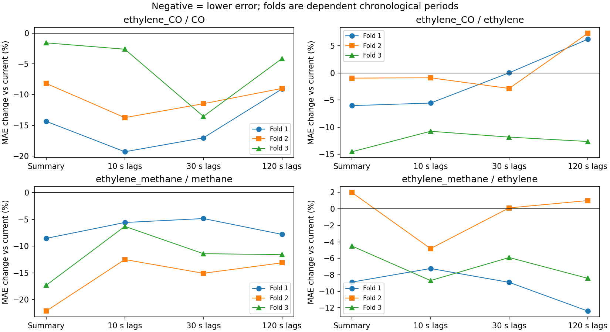
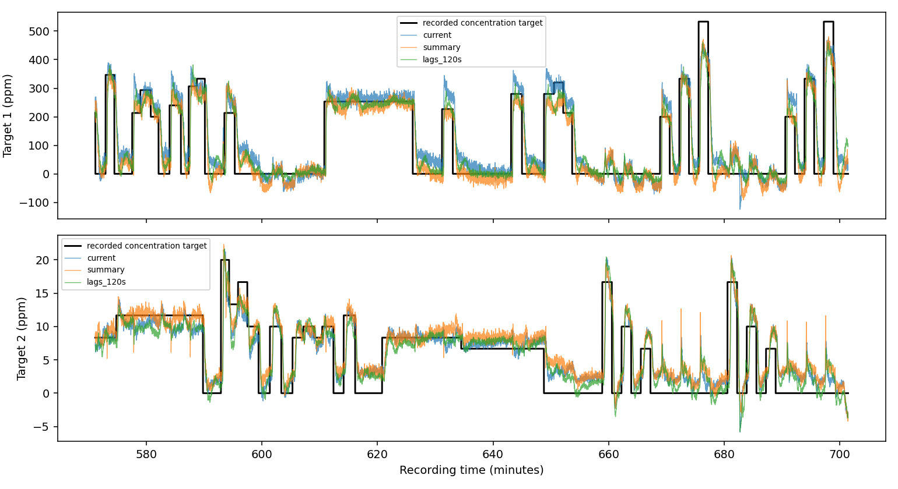

# Sensor Memory Benchmark

**Stage 2 completed: how consistently does sensor history help across periods and gas mixtures?**

Chemical sensors respond over time. This project tests whether current readings, cheap temporal summaries, or a longer sampled history better estimate the recorded concentration targets. The intended next question is whether useful temporal representations justify their memory and computational cost on an embedded device.

## Stage 2 robustness evaluation

Both UCI 322 recordings now have three expanding-window chronological evaluations,
with non-overlapping test periods and identical timestamps across five ridge
baselines. Ten-second sparse histories reduce per-gas MAE and RMSE in every
evaluated period of both mixtures. Longer sparse histories and temporal summaries
have mixed rankings; there is no universally best representation.

Read the [research report](reports/stage2_robustness.md), including the pipeline
audit, limitations, interview explanation and defensible CV wording. The
[frozen protocol](reports/stage2_protocol.md) documents the pre-evaluation design
and a raw timestamp-tie correction made before any model fitting.



Stage 2 uses full-stream causal point sampling at 1 Hz, exact EWMA constants in
seconds and separate validation-only alpha selection for each gas. These differ
from the original methodology below, so the numerical results are not a
single-factor replication. Folds within a recording are dependent, and part of
the final CO period had already appeared in the exploratory results. No claim of
statistical significance, new gas-sensing method or deployment readiness is made.

### Reproduce Stage 2

Use Python 3.12 (the recorded environment used 3.12.14). Install dependencies and
run the controls:

```sh
python -m pip install -r requirements-stage2.lock.txt
python -m unittest -v
```

One command runs the full evaluation and generates metrics and figures:

```sh
python stage2.py --download --out results/stage2_reproduction
```

The archive is about 352 MB and remains under Git-ignored `data/`. The loader
reads both complete raw members with bounded chunk memory. A new output directory
is required; completed runs are never overwritten. Numerical threads are limited
to one internally, so the command works in both PowerShell and POSIX shells.
Small floating-point differences across numerical platforms are possible.

Saved deliverables under [results/stage2](results/stage2): per-gas/fold
`metrics.csv` and JSON (absolute errors and paired changes), `config.json`,
`environment.json`, `data_checks.json`, `split_boundaries.csv`,
`distributions.csv`, `validation_selection.json`, six full-period prediction
NPZ files, MAE/RMSE comparison figures and predetermined prediction excerpts.
The [tables appendix](reports/stage2_tables.md) renders all errors, differences
and distribution summaries. The original results remain unchanged.

## Original exploratory implementation (preserved)

- UCI 322 archive loader with timestamp, shape and finite-value checks.
- Five ridge-regression baselines: current readings; current readings plus differences and exponential summaries; sparse lag features spanning 10, 30 and 120 seconds.
- Chronological 60/20/20 train/validation/test division, with excluded gaps.
- Training-only feature scaling and validation-only selection of ridge regularisation.
- Saved per-target MAE/RMSE, prediction arrays, source checksum and environment metadata.
- Tests of causal features, lag alignment and separation between partitions.

No RNN, Arm deployment, SIMD optimisation, energy measurement or physical gas detector has been implemented. This is an independent project, without company involvement. Code was developed with AI assistance.

## Reproduce the original exploratory run

Python 3.11 or newer recommended. Run from this directory:

```sh
python -m pip install -r requirements.txt
python download_data.py
python -m unittest -v
OPENBLAS_NUM_THREADS=1 python benchmark.py --out results_original_reproduction
```

On Windows omit the environment assignment or set it using your shell. The download is approximately 350 MB. Raw data are not included in the repository.

Default recording: `ethylene_CO.txt`. Targets in order: CO and ethylene, in ppm. To run the other recording:

```sh
python benchmark.py --member ethylene_methane.txt --out results_methane
```

## Original evaluation decisions and limitations

The first run subsamples every 100th raw row (no averaging or anti-alias filtering); the observed timestamp interval is recorded in `metrics.json`. Timestamp jitter and gaps are handled by causal previous-observation resampling onto a regular grid at that interval, including the target columns. The maximum original gap is logged. This can affect transition timing. Lag horizons use this interval. Exponential summary update weights are 1/(tau+1), for tau=5,30,120 samples, with effective durations depending on sampling interval.

All models use identical evaluation timestamps. A gap of at least 600 retained samples and at least the largest lag is excluded at each boundary; training also excludes initial warm-up samples. Summary states are computed causally across the stream, including excluded gaps. Exponential summaries have infinite mathematical support: this is online carry-over, not independent state reset between splits. No held-out labels enter features.

The scaler and regression coefficients are fitted on training only. Alpha is selected from 0.1, 1, 10, 100 using validation mean MAE across targets, then the unchanged model is evaluated on test. This objective weights targets equally in ppm, not by relative range. No nonnegative clipping is applied.

This is one chronological split of one laboratory recording, not evidence of generalisation to new sensors, environments or deployments. Reported prediction times are desktop batch timings excluding feature construction, not embedded latency. Sensor operating settings and concentration delivery protocols can create confounds. Targets are the dataset's recorded concentration columns; independent measurement of instantaneous concentration at each sensor has not been established here. Transition-specific errors and stronger nonlinear baselines remain future work.

The longest lag model uses only five selected lags, not a dense 120-second history. Therefore it does not test every way of exploiting long context. A linear-model failure cannot establish that history is useless.

## Next experiments

1. **Completed in Stage 2:** chronological evaluation on separated blocks and the other mixture, with distribution summaries. Quantitative transition-specific analysis remains future work.
2. Compare dense/pooled history and a compact nonlinear baseline before drawing conclusions about useful context length.
3. Audit the separate recurrent-memory dissertation implementation before considering its reuse. It is not included or validated here.
4. Compare one suitable recurrent representation with a fair raw-buffer baseline, measuring total state and model bytes.
5. Only if justified, port baselines to a chosen microcontroller and measure update cost and prediction cost separately.

## Sources

- [UCI dataset 322](https://archive.ics.uci.edu/dataset/322/gas+sensor+array+under+dynamic+gas+mixtures), DOI: 10.24432/C5WP4C. Consult the source for applicable data-use terms; this repository does not relicense the data.
- Fonollosa et al. (2015), [Reservoir computing compensates slow response of chemosensor arrays exposed to fast varying gas concentrations in continuous monitoring](https://doi.org/10.1016/j.snb.2015.03.028). Recurrence for this application is established prior work; novelty is not claimed.



## Initial result (one recording, one split)

| Model | CO MAE (ppm) | Ethylene MAE (ppm) |
|---|---:|---:|
| current | 55.983 | 2.247 |
| summary | 47.016 | 2.347 |
| lags_10s | 45.756 | 2.204 |
| lags_30s | 44.923 | 2.148 |
| lags_120s | 47.174 | 2.121 |

History improves CO error in this initial comparison. Extending sparse lags from 30 to 120 seconds does not further improve CO MAE. Ethylene results differ. These descriptive results do not establish significance, a preferred model for deployment, or a need for an RNN. No test-driven retuning was performed.
