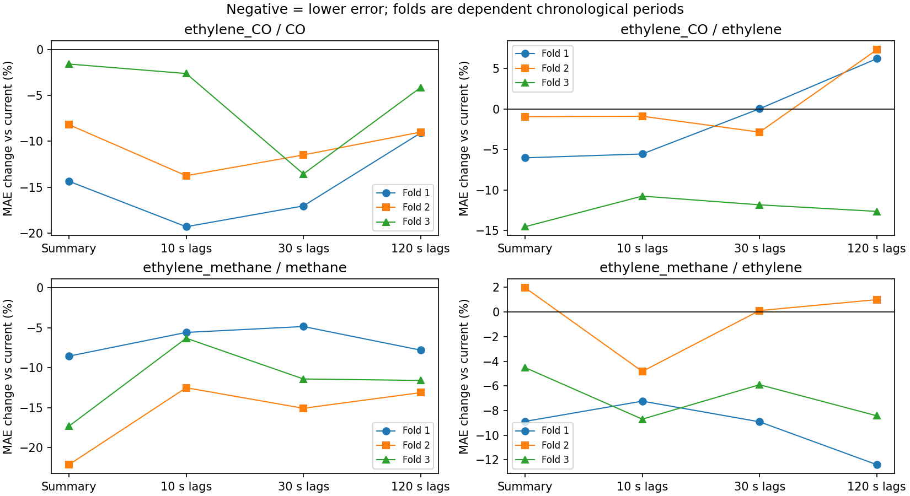
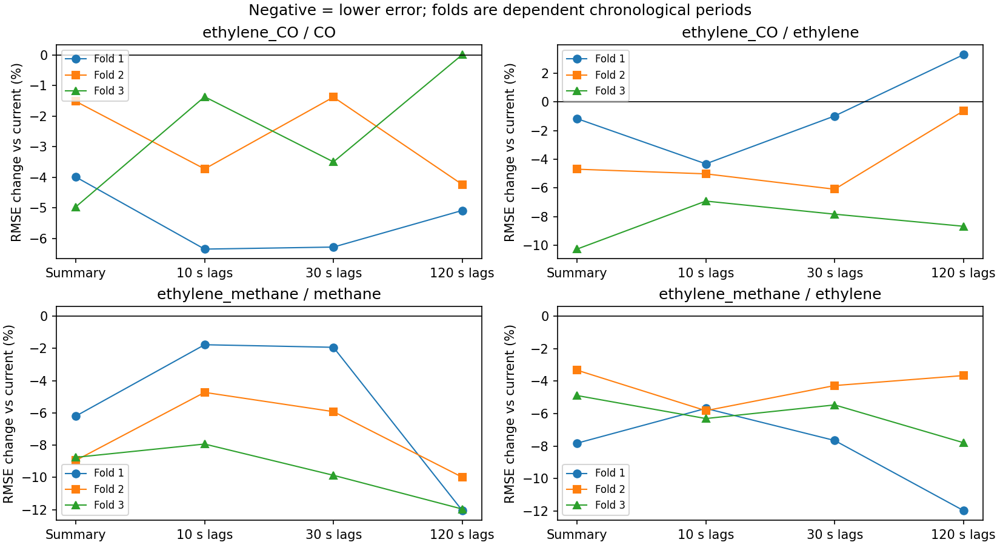
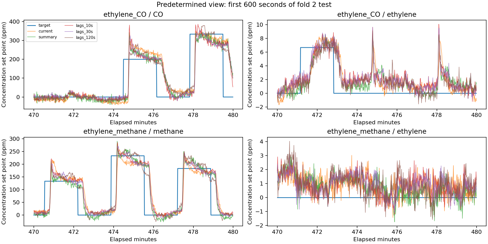

# Stage 2: chronological robustness of sensor history

Completed 5 November 2026. **Short sparse histories help consistently in this
evaluation; more history does not consistently help.** Ten-second sparse lags
lower both MAE and RMSE for each gas in all three periods of both mixtures.
This supports a further controlled representation experiment, not a new sensing
method, a neural-network requirement, or readiness for embedded deployment.

## Audit of the exploratory pipeline

The original `benchmark.py`, `results/metrics.json`, prediction arrays and figure
are preserved from commit `26706fa`. Its reported metrics were independently
recomputed from the saved predictions and agree. It evaluated CO/ethylene only,
using every 100th raw row, causal previous-observation resampling at the observed
1-second median interval, one 60/20/20 split, 600-sample gaps, and 600-sample
initial warm-up. Train/validation/test grid indices were 600–25251,
25852–33668 and 34269–42086 inclusive (7,818 test timestamps).

| Audit item | Finding and Stage 2 treatment |
|---|---|
| Target semantics | UCI columns are elapsed time, CO **or methane set point**, ethylene set point, then 16 sensor readings. They are not independently verified instantaneous concentrations at each sensor. Stage 2 names gases explicitly. |
| Raw timestamps | The original checked only stride-retained rows. Full inspection found 122,672 tied timestamp steps in CO and 104,950 in methane; no reversals. Stage 2 accepts ties, uses the last row at a tie and checks every row, including ties across read chunks. |
| Subsampling/resampling | Original stride-before-resampling is causal but can delay a transition and omit raw problems; its maximum retained-row gap was 2.89 s. Stage 2 selects the latest full-stream raw row at each integer elapsed second, sensors and labels together. This remains point sampling without anti-alias filtering. |
| Lag alignment | Original lags were correctly backward aligned. Stage 2 explicitly fixes offsets to [0,1,2,5,10], [0,1,7,15,30], [0,1,30,60,120] seconds. Five sampled sensor vectors, not a complete dense history. |
| Summary state | Original causal state carried across all boundaries; this is valid online state, not independent resets. Its weights 1/(tau+1) implied effective e-folding times about 5.485, 30.497 and 120.499 s at 1 Hz. Stage 2 uses exact 5/30/120 s constants with weight 1-exp(-1/tau). |
| Scaling/coefficients | Original fit these on training only, correctly. Stage 2 retains this and does not refit on train+validation or clip negative predictions. |
| Regularisation | Original shared alpha minimised mean validation MAE in ppm across targets, allowing CO's larger error scale to dominate. Stage 2 tunes alpha separately per gas using the same grid [0.1,1,10,100]. This changes the estimand but avoids cross-gas weighting. |
| Comparison/inference | Original timestamps were matched across models, correctly. One split cannot establish period/mixture robustness. Stage 2 matches all partitions across models and reports each gas/fold separately. |

No future-reading leakage was found in the original feature construction. The
material weaknesses were limited coverage, stride-only raw validation and shared
cross-gas regularisation selection. Stage 2 changes sampling, EWMA decay, tuning
and splits simultaneously: the new numbers cannot isolate which correction
caused any difference from the original. It does not retrospectively invalidate
the original descriptive comparison.

## Fixed evaluation and execution record

The [protocol](stage2_protocol.md) and [configuration](../stage2_config.json) were
committed at `7306996` before new model evaluation. The first preflight at
`546af54` stopped on raw timestamp ties, before any fitting. Its config/environment
are preserved in `results/stage2_attempt01_preflight`. The documented tie-handling
amendment and regression test were committed at `c96543c`, before the one completed
scientific run. No models, candidates, windows or plots were selected in response
to test errors. A synthetic timestamp test also caught floating-point cancellation
before real-data fitting; elapsed grid values are constructed directly from indices.

Both recordings were validated before any fitting. Every gas varied in every
partition. Each has three expanding training windows and disjoint test windows:

| Fold | Training [s) | Validation [s) | Test [s) | Samples train/val/test |
|---|---|---|---|---|
| 1 | [600,18000) | [18600,21600) | [22200,28200) | 17400 / 3000 / 6000 |
| 2 | [600,24000) | [24600,27600) | [28200,34200) | 23400 / 3000 / 6000 |
| 3 | [600,30000) | [30600,33600) | [34200,40200) | 29400 / 3000 / 6000 |

Time is relative to the first raw timestamp (0 s for both). Intervals include the
start and exclude the end. Initial warm-up and each excluded gap are 600 s.
The stream's sensor-only state carries through warm-up, gaps and boundaries.
At 600 s, the longest EWMA retains exp(-5), about 0.67%, of its initial-condition
weight; infinite EWMA support is not claimed to be purged. Lag features have
full observed history by training start. There are no target histories in inputs.
Scalers and coefficients use training only; validation MAE selects each gas's
alpha (first candidate on ties); the fitted model then predicts test unchanged.

Folds overlap in training. Later training and validation can include earlier test
observations, matching a rolling-origin use case. This is causal within each fold,
but the folds are dependent. Moreover the original CO results already exposed
part of Stage 2's final period: Stage 2 is not a wholly untouched confirmation set.
There is one recording per mixture, not independent repeated laboratory trials.
No significance tests, independent-fold confidence intervals or pooled-gas score
are appropriate here. The final ~1,600–1,900 seconds are deliberately outside the
fixed test windows, not removed in response to results.

The archive SHA256 is
`8b6323b801363e11343ba1a5a7718e76666b715e753b3a40dbdfd1838d953fe7`,
identical to the original run. CO has 4,208,261 raw rows ending at 42087.55 s;
methane has 4,178,504 ending at 41790.19 s. Maximum raw gaps are 0.38 and 0.27 s.
Maximum source age at any 1-second grid point is 0.15 s in both. Member checksums,
raw headers and diagnostics are in [data_checks.json](../results/stage2/data_checks.json).
The run used Python 3.12.14, NumPy 2.3.5, scikit-learn 1.8.0 and one numerical
thread on Windows; [environment.json](../results/stage2/environment.json) records
all packages, source/config hashes, Git revision and UTC timestamps.

## Absolute test errors

Cells are **MAE / RMSE in ppm**, rounded to three decimals. Gas labels include
the mixture to prevent conflating ethylene in different recordings.

| Mixture / gas | Fold | Current | Summary | 10 s lags | 30 s lags | 120 s lags |
|---|---:|---:|---:|---:|---:|---:|
| ethylene_CO / CO | 1 | 51.289 / 79.426 | 43.924 / 76.256 | 41.380 / 74.382 | 42.545 / 74.435 | 46.633 / 75.387 |
| ethylene_CO / CO | 2 | 69.745 / 111.241 | 64.042 / 109.554 | 60.154 / 107.096 | 61.736 / 109.709 | 63.478 / 106.528 |
| ethylene_CO / CO | 3 | 44.036 / 71.603 | 43.349 / 68.046 | 42.894 / 70.626 | 38.066 / 69.100 | 42.223 / 71.611 |
| ethylene_CO / ethylene | 1 | 2.403 / 3.317 | 2.258 / 3.279 | 2.269 / 3.174 | 2.404 / 3.285 | 2.552 / 3.426 |
| ethylene_CO / ethylene | 2 | 1.959 / 3.200 | 1.940 / 3.050 | 1.941 / 3.039 | 1.903 / 3.005 | 2.102 / 3.180 |
| ethylene_CO / ethylene | 3 | 2.236 / 3.162 | 1.911 / 2.837 | 1.996 / 2.943 | 1.972 / 2.914 | 1.954 / 2.888 |
| ethylene_methane / methane | 1 | 24.577 / 51.112 | 22.475 / 47.943 | 23.203 / 50.206 | 23.385 / 50.124 | 22.659 / 44.949 |
| ethylene_methane / methane | 2 | 24.294 / 43.803 | 18.920 / 39.883 | 21.256 / 41.731 | 20.632 / 41.208 | 21.108 / 39.427 |
| ethylene_methane / methane | 3 | 17.018 / 32.020 | 14.073 / 29.216 | 15.944 / 29.480 | 15.076 / 28.859 | 15.045 / 28.188 |
| ethylene_methane / ethylene | 1 | 2.304 / 3.505 | 2.100 / 3.231 | 2.138 / 3.306 | 2.099 / 3.237 | 2.019 / 3.085 |
| ethylene_methane / ethylene | 2 | 1.954 / 3.238 | 1.993 / 3.131 | 1.860 / 3.050 | 1.956 / 3.100 | 1.974 / 3.120 |
| ethylene_methane / ethylene | 3 | 2.211 / 3.567 | 2.112 / 3.393 | 2.019 / 3.342 | 2.081 / 3.372 | 2.025 / 3.289 |

The [complete tables](stage2_tables.md) include every absolute error, paired
absolute difference and percentage difference, plus all partition distributions.
Machine-readable [metrics.csv](../results/stage2/metrics.csv) and JSON retain full
precision. Negative change means improvement: `temporal - current`; percentage
is `100 * (temporal - current) / current`, always paired within recording/gas/fold.
A zero baseline produces a null percentage and `zero_baseline` status (including
0 versus 0). No denominator in this run was zero.





## What the results show

- **History helps consistently for the short sparse representation.** CO MAE
  decreases by 19.32%, 13.75% and 2.59% with 10-second lags. Methane decreases by
  5.59%, 12.50% and 6.31%. Ethylene in the CO mixture decreases by 5.56%, 0.90%
  and 10.76%; ethylene in the methane mixture by 7.23%, 4.82% and 8.70%. RMSE
  also decreases in each corresponding period. These are descriptive paired
  results, not twelve independent replications or a universal guarantee.
- **Useful history length varies.** For CO, 10-second lags have the lowest MAE
  in folds 1 and 2; 30-second lags in fold 3. Extending sparse CO lags from 30 to
  120 seconds worsens MAE in every fold. For methane, 120-second lags have lower
  RMSE than either shorter lag representation in all three folds, but summaries
  have the lowest methane MAE in all three. MAE and RMSE answer different questions.
- **More history sometimes hurts even relative to current readings.** The
  120-second model increases ethylene MAE by 6.20% and 7.30% in CO folds 1 and 2,
  and by 1.00% in methane fold 2. CO fold 3 RMSE increases by 0.011% (0.008 ppm),
  a tiny descriptive deterioration. The 30-second model's ethylene MAE increases
  by 0.018% in CO fold 1 and 0.117% in methane fold 2. These tiny changes should
  not be treated as meaningful proof of inferiority.
- **Summaries are competitive, without a formal equivalence claim.** Methane
  MAE improvements are 8.55%, 22.12% and 17.31%; summaries beat every lag model
  there. They also give the lowest ethylene MAE in CO fold 3 (1.911 ppm), but
  increase ethylene MAE by 1.97% in methane fold 2. CO summary MAE is worse than
  10-second lags in every fold. Summary RMSE improves over current in every
  gas/period, yet summaries are not uniformly best. No equivalence margin was
  defined, so “comparable” means similar practical error scale and mixed rankings.

The lag models vary **offset placement and span together**, retaining five sensor
vectors each. Thus this is not a pure dose-response experiment in history length.
The summaries also contain all three time constants together: this evaluation
does not identify an individually optimal EWMA constant.

## Distribution context and representative predictions

All evaluated CO targets range within 0–533.33 ppm, methane within 0–296.67 ppm,
and ethylene within 0–20 ppm. Full min/max, mean, population SD, 5th/50th/95th
percentiles and unique-value counts for train, validation and test are in
[distributions.csv](../results/stage2/distributions.csv) and the tables appendix.
Some important differences are visible without fitting an explanatory model:

- CO test means are 120.10, 119.01 and 99.99 ppm; fold 2 has SD 183.07 ppm versus
  146.37 and 127.66 ppm in the other periods. Its 95th percentile is 520 ppm
  versus 333.33 and 306.67 ppm. Fold 2 also has the largest absolute CO errors.
- Methane test means decline from 59.84 to 56.13 to 35.61 ppm, with SDs 84.16,
  73.25 and 54.98 ppm. Falling absolute errors therefore cannot alone establish
  better model generalisation. Paired comparisons keep the period fixed.
- Ethylene test means in the CO recording are 7.29, 3.49 and 6.83 ppm; in the
  methane recording they are 5.44, 2.99 and 6.19 ppm. Ranges alone hide these shifts.
  In methane fold 1, validation/test ethylene reaches 20 ppm although training
  reaches only 18.33 ppm. This is an observed extrapolation challenge, not leakage.



The figure shows the first 600 test seconds of fold 2 in both recordings, chosen
before results. Ethylene's target happens to be zero throughout this methane
excerpt, although it varies across the full test period. It illustrates
cross-response/offset errors; it is not representative of every target level.
All six full-period prediction arrays are retained for inspection. Predictions
can be negative because no clipping was introduced after evaluation.

**Hypotheses, not demonstrated mechanisms:** dynamic sensor response, delivery
delays and mixture cross-sensitivity could make recent history useful. Correlated
lag features, changing exposure schedules and regularisation may explain why
longer sparse spans sometimes hurt. Distribution summaries are consistent with
period differences but do not establish their cause. Errors around transitions
are visible in the plot; no separate transition-error analysis was run here.

## Cost interpretation and next experiment

Current has 16 inputs; summary and each lag model have 80. Both gases have
separately tuned ridge coefficients. Summary updates can carry three 16-channel
EWMA states plus one previous vector: 64 scalars of persistent feature state.
A straightforward 1-Hz raw ring buffer spanning 120 seconds including current
holds 121×16 = 1,936 scalars, even though only five vectors enter this lag model.
Those are representation counts, not measured total RAM: model weights, scaling,
temporaries and precision matter. The offline implementation materialises feature
matrices and is not an embedded implementation. No latency, energy, Arm or SIMD
measurement was performed.

The evidence is sufficient to justify a **new, preregistered experiment** comparing
dense/pooled history and a compact nonlinear baseline against these ridge models,
with transition-aware metrics and fresh recordings or acquisition regimes where
possible. Keep summaries and short lags as strong controls. Do not claim that
long memory or an RNN is required, or promote the observed best model without new
validation. No such next-stage model or deployment has been implemented here.

## Reproduction, checks and interview explanation

After installing [requirements-stage2.lock.txt](../requirements-stage2.lock.txt),
run from the repository root:

```sh
python stage2.py --download --out results/stage2_reproduction
```

This downloads the archive if absent and produces both recordings' checks,
configurations, split boundaries, distributions, candidate validation scores,
test metrics, predictions and figures. Use a new output directory for each
deliberate reproduction; existing outputs are never overwritten. Raw data stay
under Git-ignored `data/`. `python -m unittest -v` runs causal feature, alignment,
chunk/tie handling, malformed-row, split, train-only scaling, held-out-invariance
and zero-denominator controls. Saved-result checks independently recompute errors
and paired deltas from predictions and verify validation alpha selection.
All **13 tests passed** after completion; the saved log is
[`tests.txt`](../results/stage2/tests.txt). The MAE, RMSE and representative
prediction figures were visually inspected. One preflight failed and one full
evaluation completed; the latter was not rerun to seek different results.

For an interview, explain **why** a delayed sensor may benefit from past readings,
how a causal chronological evaluation avoids using future information, and why
validation rather than test selects alpha. Be ready to distinguish five sparse
lags from a dense buffer, set points from measured local concentration, and
descriptive consistency from statistical significance. The strongest defensible
finding is consistent short-history improvement in these two recordings, with
mixed longer-history and summary tradeoffs. Explain the duplicate-timestamp
audit and the original shared-alpha limitation. Code was developed with AI
assistance; understand and be able to explain those decisions yourself.

The completed scope justifies this more specific CV bullet (no existing CV file
was supplied or edited):

> Built and audited a reproducible gas-sensor benchmark across two UCI mixtures
> and three chronological test periods per mixture, showing consistent per-gas
> error reductions with 10-second sparse histories while documenting mixed
> benefits from longer histories and temporal summaries.

## Sources

- [UCI 322 dataset documentation](https://archive.ics.uci.edu/dataset/322/gas+sensor+array+under+dynamic+gas+mixtures),
  DOI 10.24432/C5WP4C: column meanings and recording identities. Consult UCI for
  applicable data-use terms; this repository does not relicense or redistribute raw data.
- [Fonollosa et al. (2015)](https://doi.org/10.1016/j.snb.2015.03.028): established
  prior work on dynamic chemosensor estimation. This benchmark does not claim novelty.
